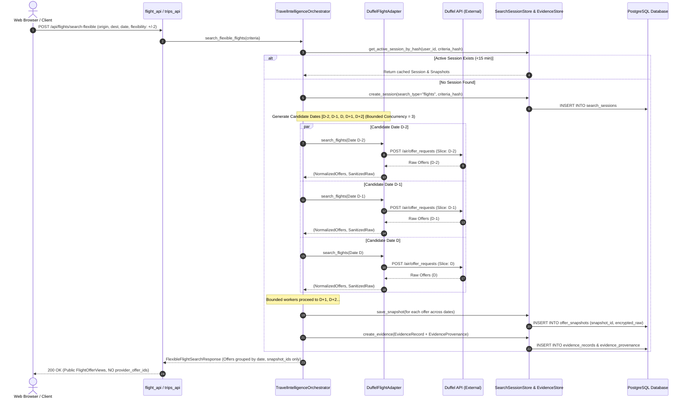
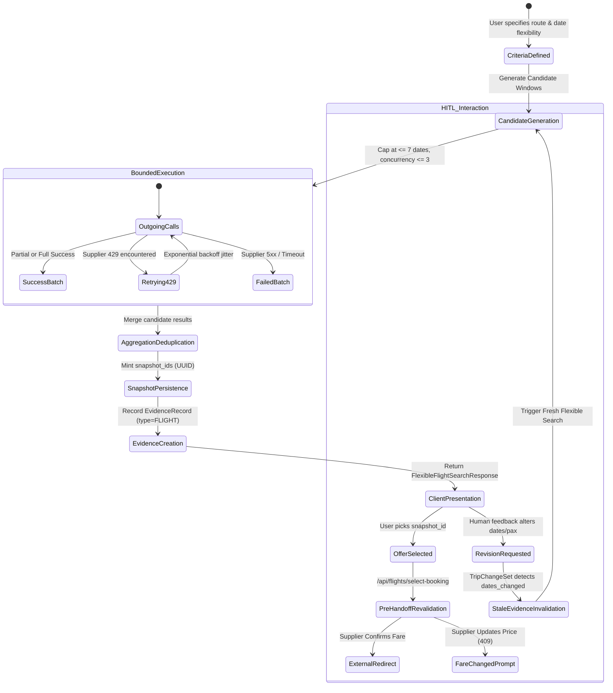

# TrustTrip — Phase 7 Gate 1 Architecture & Design
## Flexible Live Flight Search

**Status**: Architecture / Design Specification  
**Base Commit**: `8ee0275 feat: complete phase 6 evidence revision lifecycle`  
**Scope**: Gate 1 — Architecture & Technical Design (Zero Source-Code Modifications)  

---

## 1. Executive Summary & Core Objectives

Phase 7 introduces **Flexible Live Flight Search** to the TrustTrip Travel Planner platform. In real-world travel planning, travellers rarely have rigid, single-day departure constraints; they seek value, optimal schedules, and convenience across candidate date windows.

Phase 7 extends TrustTrip's existing live flight capability (backed by the Duffel flight provider adapter) to support:
1. **Exact-Date Search** (preserving full backwards compatibility with Phase 4–6).
2. **Flexible-Date Search** across configurable candidate-date windows (e.g. $\pm 1$, $\pm 2$, $\pm 3$ days or near-term ranges).
3. **Multiple Candidate Travel Dates** evaluated concurrently with rate-limit and concurrency bounds.
4. **Multiple Live Offers Per Candidate Date**, normalized, ranked, and deduplicated.
5. **Seamless Evidence Lifecycle Integration** into Phase 6 immutable `EvidenceRecord`, `EvidenceProvenance`, `SearchSession`, and `OfferSnapshot` persistence models.
6. **Strict Provider ID Shielding**: Internal Duffel offer IDs are NEVER exposed to browser clients; all client interactions utilize TrustTrip's immutable `snapshot_id` (UUID).
7. **Phase 5 Booking Handoff Preservation**: Direct selection $\to$ revalidation gate $\to$ external booking handoff without requiring whole-trip approval.
8. **Dependency-Aware Replanning**: Any date, passenger, or route mutation via HITL invalidates stale flight evidence, clearing previous selections and triggering a fresh search, while hotel-only or activity-only edits leave flight evidence intact.

---

## 2. Invariants Preserved from Phase 1–6

The following core invariants are strictly frozen and will not be altered or weakened:

| Invariant ID | Domain / Subsystem | Description & Contract Guarantee |
| :--- | :--- | :--- |
| **INV-01** | **Tenancy & Ownership** | Every `trip_id`, `session_id`, `snapshot_id`, `evidence_id`, and `revision_id` is strictly tenant-scoped to `user_id`. Cross-tenant queries return 404 or 403. |
| **INV-02** | **Provider ID Shielding** | Supplier offer IDs (`provider_offer_id`) are stored encrypted or server-side only; client view models (`FlightOfferView`) expose only `snapshot_id`. |
| **INV-03** | **Offer Immutability** | `OfferSnapshot` records are append-only and unconditionally immutable. Price/schedule changes produce successor snapshots with `predecessor_snapshot_id`. |
| **INV-04** | **Evidence Immutability** | `EvidenceRecord` content is write-once, immutable, and protected by PostgreSQL triggers (`trg_evidence_record_immutability`). |
| **INV-05** | **Attach-Once Provenance** | `EvidenceProvenance` binds an `EvidenceRecord` to `supplier_session_id` and `supplier_snapshot_id` at creation; updates are strictly prohibited. |
| **INV-06** | **Parent Trip Locking** | Universal parent trip row locking (`SELECT id, user_id ... FOR UPDATE`) is acquired before publishing revisions, deleting revisions, or modifying approval state. |
| **INV-07** | **Optimistic Revision Locking** | Publishing a revision enforces `expected_base_revision`. Mismatches abort with HTTP 409 Conflict. |
| **INV-08** | **Two-Way Approval Invariant** | A trip status can only be `approved` if linked to an active `PlanApproval` pointing to the `current_revision_id`. Direct deletion cascades safely. |
| **INV-09** | **Booking Independence** | Flight selection and external handoff (`/api/flights/select-booking`) do **NOT** require whole-trip `approved` status. |
| **INV-10** | **Zero URL Fabrication** | External handoff URLs are restricted to verified carrier domains (`CARRIER_DOMAIN_ALLOWLIST`) or Duffel Link checkouts. No fake URLs are ever generated. |
| **INV-11** | **No Artificial HITL Limits** | No `MAX_PLAN_REVISIONS` or artificial revision caps. The HITL loop supports unlimited refinements. |
| **INV-12** | **Provider Isolation** | Duffel API client logic remains strictly behind `FlightSearchProviderPort` and provider adapter boundaries. |

---

## 3. Detailed Architecture Specifications (A–J)

### A. Candidate-Date Generation

The candidate-date generation engine maps user intent and travel constraints into a bounded, deduplicated sequence of candidate travel date pairs:

```
(departure_date: date, return_date: date | None)
```

#### 1. Generation Modes
- **`EXACT` Mode**: When the user specifies an exact departure date without flexibility flags (or `flexibility_days == 0`). Yields exactly 1 candidate date pair:
  $$\text{Window} = \{(D_{\text{dep}}, R_{\text{ret}})\}$$
- **`PLUS_MINUS_N` ($\pm N$ Days) Mode**: When the user specifies a base departure date $D_{\text{dep}}$ and requests flexible dates (e.g., $\pm 1, \pm 2, \pm 3$ days):
  - For departure: $D_i = D_{\text{dep}} + i \quad \text{for } i \in [-N, +N]$.
  - For round-trip: If an explicit return date $R_{\text{ret}}$ or duration $L$ is set, the return date is shifted concurrently ($R_i = R_{\text{ret}} + i$ or $R_i = D_i + L$) to preserve trip duration, or paired with a cross-product window if flexible duration is explicitly configured.
  - Hard constraint: $N \le 3$, producing at most $2N + 1 \le 7$ candidate departure dates.
- **`DATE_RANGE` Mode**: Given an earliest departure $D_{\text{min}}$ and latest departure $D_{\text{max}}$, generates candidate departure dates at regular intervals (daily or step of 2 days), capped at $\le 7$ dates.
- **`NEAR_TERM_FALLBACK` Mode**: When no travel dates are supplied in initial planning, the system selects near-term candidate windows starting from $T_{\text{today}} + 2 \text{ days}$ spaced by 3 days, yielding up to 3 candidate windows.

#### 2. Validation & Normalization Rules
1. **Past Date Pruning**: All candidate departure dates $D_i < \text{date.today()}$ (evaluated in UTC) are pruned immediately.
2. **Chronological Validity**: For round-trip requests, $R_i \ge D_i$ must strictly hold. Any window where $R_i < D_i$ is discarded.
3. **Calendar Normalization**: Dates are represented exclusively as ISO-8601 calendar dates `YYYY-MM-DD` (`datetime.date`). No ambiguous local timezone offsets are passed to flight slice queries.
4. **Deduplication**: Candidate pairs are normalized into a deterministic, ordered list of unique tuples `[(dep_1, ret_1), (dep_2, ret_2), ...]`.

---

### B. Search Execution & Provider Protection

Duffel's flight search API (`POST /air/offer_requests`) operates on concrete flight slices with exact departure dates. Supporting flexible search requires orchestrating queries across multiple candidate slices while safeguarding against supplier timeouts and rate limits.

```
Candidate Dates [D-1, D, D+1] 
         │
         ▼
┌────────────────────────────────────────┐
│  asyncio.Semaphore(limit=3)            │
│  Bounded Concurrency Execution Pool    │
└──────────────────┬─────────────────────┘
                   │
       ┌───────────┼───────────┐
       ▼           ▼           ▼
   Worker 1    Worker 2    Worker 3
   (Date -1)   (Date 0)    (Date +1)
       │           │           │
       ▼           ▼           ▼
  Duffel API  Duffel API  Duffel API
```

#### 1. Concurrency Model: Bounded Async Concurrency
- Searches across candidate dates are executed concurrently using `asyncio.gather` bounded by an `asyncio.Semaphore(CONCURRENCY_LIMIT)`.
- **Default Concurrency Limit**: 3 concurrent outgoing HTTP calls.
- **Maximum Candidate Dates**: 7 dates (strictly enforced by validation).

#### 2. Rate-Limit & Backoff Strategy
- **HTTP 429 Handling**: If Duffel returns HTTP 429 (Too Many Requests), the adapter applies an exponential backoff with jitter (initial delay 500ms, max 2 retries).
- **HTTP 5xx / Network Errors**: Retried at most once per candidate date.
- **HTTP 400 / 422 Client Errors**: Fail immediately without retry (invalid parameters).

#### 3. Partial Failure Resilience
- If one candidate date encounters an error (e.g. no flights operated on that day, or supplier timeout on slice $D_k$), the failure is isolated.
- Successful candidate dates are retained and returned to the caller.
- Candidate-level warnings are appended to the search response:
  $$\text{offers} = \bigcup_{k \in \text{successful}} \text{offers}_k, \quad \text{errors} = \bigcup_{k \in \text{failed}} \{\text{error}_k\}$$
- Only if **ALL** candidate dates fail does the overall search return an error (HTTP 502/504).

#### 4. Timeout Budgeting
- **Per-Candidate Call Timeout**: 15 seconds.
- **Overall Search Orchestration Timeout**: 35 seconds (enforced via `asyncio.wait_for`).

---

### C. Offer Aggregation & Representation

#### 1. Multi-Date Offer Structure
Each retrieved offer is normalized into the canonical `FlightOffer` domain model, augmented with candidate date metadata:
- `departure_date`: `date` of the outward journey.
- `return_date`: `date | None` of the return journey.
- `candidate_date_id`: Unique deterministic hash of the candidate date pair `YYYY-MM-DD[_YYYY-MM-DD]`.

#### 2. Identity & Snapshot Generation
- Every individual offer across all candidate dates receives an authoritative, cryptographically random `snapshot_id: UUID`.
- Stored as an immutable `OfferSnapshot` in the database, with `raw_payload_encrypted` via AES-256-GCM.
- The `provider_offer_id` is strictly shielded. Client responses receive only `snapshot_id`.

#### 3. Deduplication Criteria
Within each candidate date window, duplicate offers from the same airline on the same flight numbers and departure times are deduplicated:
$$\text{Signature} = (\text{marketing\_carrier}, \text{flight\_number}, \text{departure\_time}, \text{arrival\_time}, \text{cabin\_class})$$
If multiple offers match the same signature, the lowest total price is retained.

#### 4. Ranking & Recommendation
- **Per-Date Ranking**: Within each candidate date, offers are ranked by:
  1. User preference match (nonstop > morning/afternoon/evening departure).
  2. Total price (ascending).
  3. Total travel duration (ascending).
- **Global Recommendation**: The top-ranked offer on the user's preferred travel date (or the overall best-value offer across all dates if dates are fully flexible) is flagged with:
  - `is_recommended = True`
  - `recommendation_rank = 1`

#### 5. Financial Representation & Currency
- Price breakdown uses Python `Decimal`: `base_amount`, `tax_amount`, `fee_amount`, `total_amount`, and `currency`.
- Transparent INR reference conversion (`inr_reference_amount`, `fx_rate_applied`) is attached for UI display without mutating the supplier's authoritative booking currency.

---

### D. Evidence Lifecycle Integration (Phase 6 Alignment)

Every flexible flight search maps directly into the Phase 6 evidence and revision architecture:

```
┌────────────────────────────────────────────────────────┐
│                   SearchSession                        │
│  search_type: "flights", criteria_hash: SHA-256(...)   │
│  trip_id, user_id, trip_revision, expires_at (15 min)  │
└───────────────────────────┬────────────────────────────┘
                            │ 1 : N
                            ▼
┌────────────────────────────────────────────────────────┐
│                   OfferSnapshot                        │
│  snapshot_id (UUID), session_id, price_total, currency  │
│  normalized_offer (JSONB), raw_payload_encrypted (AES) │
└───────────────────────────┬────────────────────────────┘
                            │ 1 : 1 (Top / Chosen Offer)
                            ▼
┌────────────────────────────────────────────────────────┐
│                EvidenceProvenance                      │
│  evidence_id, supplier_session_id, supplier_snapshot_id│
└───────────────────────────┬────────────────────────────┘
                            │ 1 : 1
                            ▼
┌────────────────────────────────────────────────────────┐
│                  EvidenceRecord                        │
│  evidence_id, evidence_type: FLIGHT, applicability_hash│
│  freshness_ttl_seconds: 1800, content_hash, payload    │
└───────────────────────────┬────────────────────────────┘
                            │ 1 : N
                            ▼
┌────────────────────────────────────────────────────────┐
│             PlanRevisionEvidenceLink                   │
│  revision_id, evidence_id, usage_state: FRESH/REUSED   │
└────────────────────────────────────────────────────────┘
```

#### 1. SearchSession & Cache Reuse
- A `SearchSession` is recorded with `criteria_hash` computed over the full flexible criteria (including `origin`, `destination`, `passengers`, `cabin_class`, and the normalized candidate date window list).
- If an active, non-expired session exists ($< 15 \text{ minutes}$ TTL) for the identical criteria hash under the same `(user_id, trip_id)`, cached snapshots may be reused to prevent supplier call explosion.

#### 2. EvidenceRecord Construction
- An `EvidenceRecord` of type `FLIGHT` is emitted containing:
  - `applicability_key`: `{origin, destination, departure_date_start, departure_date_end, return_date, adults, children, infants, cabin_class}`.
  - `payload`: Aggregated summary, date-by-date candidate summaries, and top offers per candidate date (using public `snapshot_id` references).
  - `freshness_ttl_seconds`: 1800 (30 minutes).

#### 3. Revision Linkage & Dependency Invalidation
- When a `PlanRevision` is published, the `EvidenceRecord` is linked via `PlanRevisionEvidenceLink`.
- **Invalidation Triggers** (`TripChangeSet` evaluation in `services/evidence_policy.py`):
  - `dates_changed == True`: Marks flight evidence as `INVALID_FOR_REVISION`.
  - `passengers_changed == True`: Marks flight evidence as `INVALID_FOR_REVISION`.
  - `origin_changed == True` or `destination_changed == True`: Marks flight evidence as `INVALID_FOR_REVISION`.
  - `flight_preferences_changed == True`: Marks flight evidence as `INVALID_FOR_REVISION`.
  - Stale flight selection (`selected_flight_snapshot_id`) is purged automatically.
- **Selective Retention (Reused Evidence)**:
  - Hotel-only changes, activity changes, or freeform itinerary notes do NOT invalidate `FLIGHT` evidence. The existing fresh flight evidence is linked with `UsageState.REUSED`, avoiding unnecessary flight supplier calls.

---

### E. API & Domain Contracts

#### 1. Request Models
```python
from datetime import date
from enum import StrEnum
from pydantic import BaseModel, ConfigDict, Field

class DateFlexibilityMode(StrEnum):
    EXACT = "exact"
    PLUS_MINUS_DAYS = "plus_minus_days"
    DATE_RANGE = "date_range"

class FlexibleDateOptions(BaseModel):
    model_config = ConfigDict(extra="forbid", frozen=True)
    mode: DateFlexibilityMode = DateFlexibilityMode.EXACT
    flexibility_days: int = Field(default=0, ge=0, le=3)
    earliest_departure: date | None = None
    latest_departure: date | None = None

class FlexibleFlightSearchCriteria(BaseModel):
    model_config = ConfigDict(extra="forbid", frozen=True)
    origin_iata: str = Field(min_length=3, max_length=3)
    destination_iata: str = Field(min_length=3, max_length=3)
    departure_date: date
    return_date: date | None = None
    flexibility: FlexibleDateOptions = Field(default_factory=FlexibleDateOptions)
    adults: int = Field(default=1, ge=1, le=9)
    children: int = Field(default=0, ge=0, le=9)
    infants: int = Field(default=0, ge=0, le=9)
    cabin_class: str = "economy"
    max_connections: int = Field(default=2, ge=0, le=4)
    currency: str = "USD"
```

#### 2. Response & Projection Models
```python
from decimal import Decimal
from uuid import UUID

class CandidateDateSummary(BaseModel):
    model_config = ConfigDict(extra="forbid", frozen=True)
    departure_date: date
    return_date: date | None = None
    offer_count: int
    lowest_price: Decimal | None
    currency: str
    status: str  # "ok", "no_offers", "provider_error"
    error_message: str | None = None

class FlexibleFlightSearchResponse(BaseModel):
    model_config = ConfigDict(extra="forbid", frozen=True)
    success: bool
    session_id: UUID
    candidate_dates: list[CandidateDateSummary]
    offers_by_date: dict[str, list[FlightOfferView]]  # ISO date string -> offers
    cheapest_offer: FlightOfferView | None = None
    recommended_offer: FlightOfferView | None = None
    errors: list[str] = Field(default_factory=list)
```

---

### F. LangGraph Integration

#### 1. Affected Nodes & Topology
No global redesign of the LangGraph execution graph. The supervisor and specialist pipeline remains:

```
[START]
   │
   ▼
[supervisor_agent]
   │
   ▼
[flight_agent]  <─── Enhanced for Candidate Windows & Flexible Execution
   │
   ▼
[hotel_agent]   <─── Grounds on recommended/selected candidate flight date
   │
   ▼
[weather_agent]
   │
   ▼
[budget_agent]  <─── Aggregates recommended flight + hotel totals
   │
   ▼
[itinerary_agent]
   │
   ▼
[human_feedback_node (interrupt)]
   │
   ▼
[END]
```

#### 2. State Modifications (`TravelState`)
The `TravelState` TypedDict retains all existing fields and introduces optional flexible flight keys:
- `flight_candidate_dates`: `list[dict[str, Any]]` — Summaries of candidate date windows searched.
- `selected_candidate_date`: `str | None` — Date window currently bound to the itinerary.
- `live_flight_offers`: Continues to hold ranked `FlightOffer` objects (or client views), tagged with `planning_departure` and `planning_return`.

#### 3. Routing & HITL Coordination
- `flight_agent` inspects `trip_constraints`:
  - If `flexible_dates` is requested (or departure date is not pinned to a single day), it generates candidate windows via the candidate-date generator and dispatches the bounded search orchestrator.
  - When the user selects an offer from any candidate date via `/api/trips/{trip_id}/select-offer`, the trip constraints and itinerary align to that specific date.
  - When user revises travel dates or passenger mix via `/api/trips/{trip_id}/revisions`, `TripChangeSet` detects the mutation, invalidates flight evidence, and automatically triggers `flight_agent` during replanning.

---

### G. Security Threat Model

| Threat ID | Threat Vector | Mitigation & Architectural Defense |
| :--- | :--- | :--- |
| **SEC-01** | **Provider Offer ID Exfiltration** | Duffel offer IDs are NEVER included in `FlightOfferView` or REST output. Only server-generated `snapshot_id` UUIDs are exposed. |
| **SEC-02** | **Cross-Tenant Snapshot Theft** | `SearchSessionStore.get_snapshot` joins on `search_sessions` and strictly verifies `ss.user_id == current_user.id`. |
| **SEC-03** | **Provider Rate-Limit Exhaustion (DoS)** | Hard limit of $\le 7$ candidate dates, bounded concurrency pool ($\le 3$), and 15-minute search session caching. |
| **SEC-04** | **PII & Credential Leakage** | All supplier payloads scrubbed of authorization tokens and passenger PII before AES-256-GCM encryption in `offer_snapshots`. |
| **SEC-05** | **Arbitrary Redirection / Phishing** | External flight checkout URLs must match `CARRIER_DOMAIN_ALLOWLIST` or exact `duffel.com`/`duffel.link` hostnames. IP literals and localhost rejected. |
| **SEC-06** | **Concurrent Booking Race Conditions** | Pre-handoff revalidation confirms fare and inventory directly with Duffel before issuing redirect URLs. |

---

### H. Testing Strategy

| Test Layer | Test Identifier | Scope & Validation Objective |
| :--- | :--- | :--- |
| **Unit** | `test_candidate_dates_exact` | Verifies exact date yields exactly 1 candidate pair. |
| **Unit** | `test_candidate_dates_plus_minus_n` | Verifies $\pm 1$, $\pm 2$, $\pm 3$ days window expansion and duration preservation. |
| **Unit** | `test_candidate_dates_past_pruning` | Verifies dates before today are pruned. |
| **Unit** | `test_candidate_dates_max_bound` | Verifies date windows cannot exceed 7 candidate dates. |
| **Unit** | `test_offer_deduplication` | Verifies duplicate flight signatures within a date are deduplicated to lowest price. |
| **Unit** | `test_provider_id_shielding` | Asserts `provider_offer_id` is excluded from all client-facing view projections. |
| **Adapter** | `test_duffel_flexible_concurrency` | Verifies bounded concurrency semaphore limits parallel outgoing HTTP requests to $\le 3$. |
| **Adapter** | `test_duffel_partial_date_failure` | Verifies that when 1 of 3 candidate dates fails, the other 2 candidate dates succeed and are returned. |
| **Integration**| `test_flexible_search_evidence_linkage`| Verifies `EvidenceRecord` and `EvidenceProvenance` are generated with correct hashes. |
| **Integration**| `test_hitl_date_change_invalidation` | Verifies date mutation marks `FLIGHT` evidence `INVALID_FOR_REVISION` and clears selection. |
| **Integration**| `test_hitl_hotel_only_change_reuse` | Verifies hotel preference change keeps flight evidence as `UsageState.REUSED`. |
| **Postgres** | `test_postgres_flexible_snapshots` | Validates session, snapshot, and evidence insertion in real PostgreSQL with triggers. |
| **Regression**| `test_phase5_handoff_preserved` | Verifies `select_and_handoff_flight` executes without requiring whole-trip approval. |
| **Regression**| `test_phase6_revision_lifecycle` | Runs full Phase 6 test suite to ensure zero regressions on frozen revision contracts. |

---

### I. Backward Compatibility

1. **Existing Exact-Date Searches**:
   - Calls to `/api/flights/search` or requests with standard `FlightSearchCriteria` continue to execute as single-date searches with identical request/response semantics.
2. **Phase 5 Flight Handoff**:
   - `/api/flights/select-booking` continues to accept `snapshot_id` and return `FlightBookingDestination`. It does not require any new parameters.
3. **Trip Planning Endpoints**:
   - `/api/trips/{trip_id}/select-offer` continues to bind flight snapshots by `snapshot_id`.
4. **Hotel Booking & Payment**:
   - Hotel search, room selection, Razorpay payment capture, and PDF confirmation remain completely decoupled and unaffected.

---

### J. Performance & Scalability Guardrails

- **Maximum Candidate Dates**: Hard limit of 7 dates.
- **Bounded Concurrency**: Maximum 3 concurrent provider calls per user search.
- **Session Reuse TTL**: 15 minutes (`session_reuse_expires_at`). Repeated identical searches within 15 minutes reuse the persisted session.
- **Timeout Budget**: Total request timeout 35 seconds, per-date timeout 15 seconds.

---

## 4. Proposed File & Module Changes

```
┌────────────────────────────────────────────────────────────────────────┐
│ Module / File                                      │ Planned Action    │
├────────────────────────────────────────────────────┼───────────────────┤
│ domain/search_criteria.py                          │ MODIFY (Extend)   │
│   - Add DateFlexibilityMode, FlexibleDateOptions   │ Non-breaking      │
│   - Extend FlightSearchCriteria with flexibility   │                   │
├────────────────────────────────────────────────────┼───────────────────┤
│ domain/live_offer.py                               │ MODIFY (Extend)   │
│   - Add CandidateDateSummary, FlexibleFlightResult │ Non-breaking      │
│   - Add candidate date context to FlightOfferView  │                   │
├────────────────────────────────────────────────────┼───────────────────┤
│ services/travel_planner.py                         │ MODIFY (Extend)   │
│   - Upgrade candidate_dates() to support flexible  │ Non-breaking      │
│     modes (+/- N days, date ranges, constraints)   │                   │
├────────────────────────────────────────────────────┼───────────────────┤
│ services/travel_intelligence/ports.py              │ MODIFY (Extend)   │
│   - Update ProviderCapability flag for flexible    │ Non-breaking      │
│     dates support                                  │                   │
├────────────────────────────────────────────────────┼───────────────────┤
│ services/travel_intelligence/duffel_adapter.py     │ MODIFY (Extend)   │
│   - Implement flexible multi-date search method    │ Non-breaking      │
│   - Bounded concurrency with asyncio.Semaphore     │                   │
├────────────────────────────────────────────────────┼───────────────────┤
│ services/travel_intelligence/orchestrator.py       │ MODIFY (Extend)   │
│   - Add search_flexible_flights() orchestration    │ Non-breaking      │
│   - Snapshot persistence across candidate dates    │                   │
├────────────────────────────────────────────────────┼───────────────────┤
│ backend.py (flight_agent)                          │ MODIFY (Extend)   │
│   - Ground flight_agent on candidate dates engine  │ Non-breaking      │
│   - Preserve rank and downstream state contracts   │                   │
├────────────────────────────────────────────────────┼───────────────────┤
│ flight_api.py                                      │ MODIFY (Extend)   │
│   - Add POST /api/flights/search-flexible endpoint │ Non-breaking      │
│   - Retain POST /api/flights/search unchanged      │                   │
├────────────────────────────────────────────────────┼───────────────────┤
│ migrations/006_flexible_flight_indexes.sql         │ NEW (Optional)    │
│   - Optional composite query index (zero DDL break)│ Non-breaking      │
├────────────────────────────────────────────────────┼───────────────────┤
│ tests/test_phase7_flexible_flight_search.py        │ NEW               │
│   - Full unit, adapter, concurrency, HITL suite    │                   │
└────────────────────────────────────────────────────┴───────────────────┘
```

---

## 5. Domain & Data-Flow Diagram



---

## 6. State Transition Diagram



---

## 7. API Contract Proposal

### Endpoint 1: Flexible Flight Search
- **Route**: `POST /api/flights/search-flexible`
- **Auth**: Requires `Authorization: Bearer <token>` (`get_current_user`).
- **Request Body**:
  ```json
  {
    "origin_iata": "LHR",
    "destination_iata": "JFK",
    "departure_date": "2026-10-15",
    "return_date": "2026-10-22",
    "flexibility": {
      "mode": "plus_minus_days",
      "flexibility_days": 2
    },
    "adults": 1,
    "children": 0,
    "infants": 0,
    "cabin_class": "economy"
  }
  ```
- **Response Body (`200 OK`)**:
  ```json
  {
    "success": true,
    "session_id": "8a3e7b19-4567-4221-9988-123456789abc",
    "candidate_dates": [
      {
        "departure_date": "2026-10-13",
        "return_date": "2026-10-20",
        "offer_count": 4,
        "lowest_price": "480.00",
        "currency": "USD",
        "status": "ok",
        "error_message": null
      },
      {
        "departure_date": "2026-10-15",
        "return_date": "2026-10-22",
        "offer_count": 8,
        "lowest_price": "420.50",
        "currency": "USD",
        "status": "ok",
        "error_message": null
      }
    ],
    "offers_by_date": {
      "2026-10-15": [
        {
          "snapshot_id": "c1f7a4e2-9b22-481b-a5f1-3d7120a11e40",
          "provider": "duffel",
          "price": {
            "base_amount": "380.00",
            "tax_amount": "40.50",
            "fee_amount": "0.00",
            "total_amount": "420.50",
            "currency": "USD",
            "inr_reference_amount": "35111.75",
            "fx_rate_applied": "83.50"
          },
          "stops": 0,
          "segments": [
            {
              "origin_iata": "LHR",
              "destination_iata": "JFK",
              "departure_time": "2026-10-15T10:00:00Z",
              "arrival_time": "2026-10-15T13:00:00Z",
              "marketing_carrier_iata": "BA",
              "marketing_carrier_name": "British Airways",
              "flight_number": "117",
              "duration_minutes": 480,
              "cabin_class": "economy"
            }
          ],
          "passenger_count": 1,
          "available_seats": 9,
          "retrieved_at": "2026-09-23T06:00:00Z",
          "expires_at": "2026-09-23T06:30:00Z",
          "freshness": "fresh",
          "availability": "available",
          "limitations": [],
          "is_recommended": true,
          "recommendation_rank": 1
        }
      ]
    },
    "cheapest_offer": {
      "snapshot_id": "c1f7a4e2-9b22-481b-a5f1-3d7120a11e40",
      "price": { "total_amount": "420.50", "currency": "USD" }
    },
    "recommended_offer": {
      "snapshot_id": "c1f7a4e2-9b22-481b-a5f1-3d7120a11e40"
    },
    "errors": []
  }
  ```

### Endpoint 2: Existing Handoff Preserved
- **Route**: `POST /api/flights/select-booking`
- **Request Body**: `{"snapshot_id": "c1f7a4e2-9b22-481b-a5f1-3d7120a11e40"}`
- **Behavior**: Unchanged from Phase 5. Revalidates snapshot with supplier, resolves verified carrier domain or Duffel link checkout, and returns `FlightBookingDestination`.

---

## 8. Database Impact Assessment & Migration

### Schema Assessment
Phase 4 (`004_travel_intelligence.sql`) and Phase 6 (`005_evidence_revision_lifecycle.sql`) were architected with extensible schemas:
1. `search_sessions`: Column `search_type VARCHAR(32)` natively supports `'flights'` and `'flexible_flights'`. Column `criteria_hash` accommodates hashed flexible parameters.
2. `offer_snapshots`: Column `offer_type` is an enum (`'flight'`, `'hotel'`). Column `normalized_offer` is `JSONB`, which naturally holds candidate departure/return dates.
3. `evidence_records`: Column `evidence_type` is an enum (`'FLIGHT'`). `applicability_key` and `payload` are `JSONB`.
4. `evidence_provenance`: Attaches `supplier_session_id` and `supplier_snapshot_id`.

### Migration Decision: Zero DDL Breaking Changes
- **No breaking DDL is required.** All existing tables, triggers, and immutability invariants natively accommodate Phase 7 flexible flight data.
- **Optional Performance Index Migration (`migrations/006_flexible_flight_indexes.sql`)**:
  An optional, non-blocking index can be added to optimize candidate-date snapshot retrieval:
  ```sql
  -- Optional non-blocking optimization index
  CREATE INDEX IF NOT EXISTS idx_offer_snapshots_session_retrieved
  ON offer_snapshots (session_id, retrieved_at DESC);
  ```

---

## 9. Comprehensive Test Matrix

| # | Test Case Description | Test Type | File Location | Expected Result |
| :--- | :--- | :--- | :--- | :--- |
| 1 | Exact date search yields exactly 1 candidate date pair | Unit | `tests/test_phase7_flexible_flight.py` | Length of candidate list == 1 |
| 2 | $\pm 2$ days flexible search generates 5 ordered pairs | Unit | `tests/test_phase7_flexible_flight.py` | 5 pairs with synchronized return dates |
| 3 | Past candidate dates are automatically pruned | Unit | `tests/test_phase7_flexible_flight.py` | Zero dates earlier than today |
| 4 | Candidate window exceeds maximum cap ($\gt 7$) | Unit | `tests/test_phase7_flexible_flight.py` | Pydantic ValidationError or clamped to 7 |
| 5 | Within-date duplicate flight offers are deduplicated | Unit | `tests/test_phase7_flexible_flight.py` | Single offer with lowest price retained |
| 6 | Bounded concurrency executes at most 3 simultaneous calls | Adapter | `tests/test_phase7_flexible_flight.py` | Active semaphore counter $\le 3$ at all times |
| 7 | Partial candidate date failure retains successful dates | Adapter | `tests/test_phase7_flexible_flight.py` | 2 of 3 succeed, result contains 2 dates + 1 error |
| 8 | Supplier 429 triggers exponential backoff retry | Adapter | `tests/test_phase7_flexible_flight.py` | Retries once, succeeds without failing search |
| 9 | `provider_offer_id` is never serialized in client responses | Security | `tests/test_phase7_flexible_flight.py` | "provider_offer_id" not in client JSON |
| 10 | Cross-tenant access to another user's snapshot returns 403/404 | Security | `tests/test_phase7_flexible_flight.py` | HTTP 403 Forbidden |
| 11 | Phase 5 flight handoff works without trip approval | Integration | `tests/test_phase7_flexible_flight.py` | Returns valid booking redirect |
| 12 | HITL date revision marks flight evidence `INVALID_FOR_REVISION` | Integration | `tests/test_phase7_flexible_flight.py` | `UsageState.INVALID_FOR_REVISION` + triggers search |
| 13 | HITL hotel-only change retains flight evidence as `REUSED` | Integration | `tests/test_phase7_flexible_flight.py` | `UsageState.REUSED` + zero Duffel calls |
| 14 | Real PostgreSQL snapshot & evidence persistence | DB Integration | `tests/integration/test_phase7_postgres.py` | Commits cleanly, triggers pass, tenant checks pass |
| 15 | Full Phase 1–6 regression verification | Regression | `tests/` | All previous suites pass cleanly |

---

## 10. Gate 1 Verdict

```
================================================================================
GATE 1 VERDICT:
APPROVED
================================================================================
```

### Architectural Verdict Summary:
1. **Contract Preservation**: Preserves all Phase 1–6 domain, database, and API contracts.
2. **LangGraph Integrity**: No global graph redesign; `flight_agent` is seamlessly extended within the existing supervisor-specialist pipeline.
3. **Evidence Lifecycle**: Full alignment with Phase 6 `EvidenceRecord`, `EvidenceProvenance`, and `PlanRevisionEvidenceLink`.
4. **Security & Ownership**: Zero leakage of internal provider IDs; strict URL validation; robust tenant isolation.
5. **Readiness**: Ready to proceed to Gate 2 (Implementation) upon user confirmation. Zero source-code files were modified during Gate 1.
