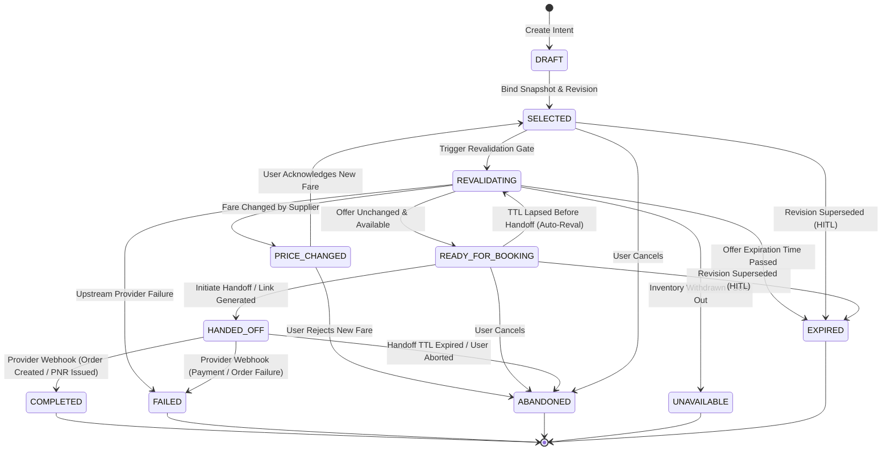
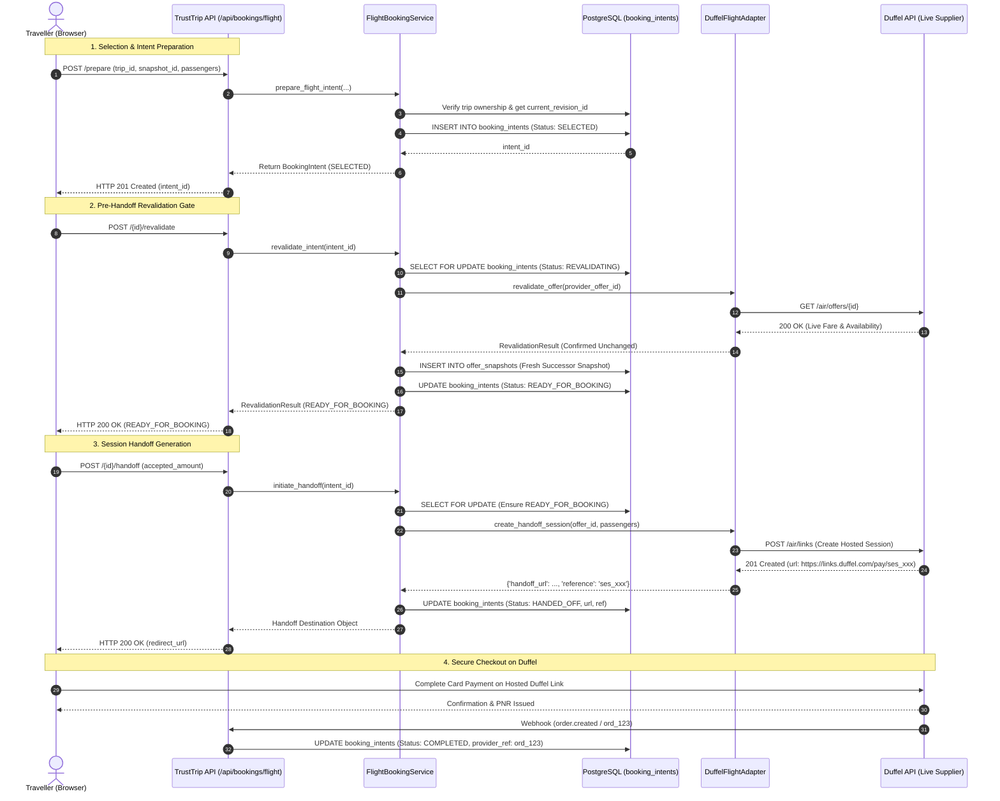
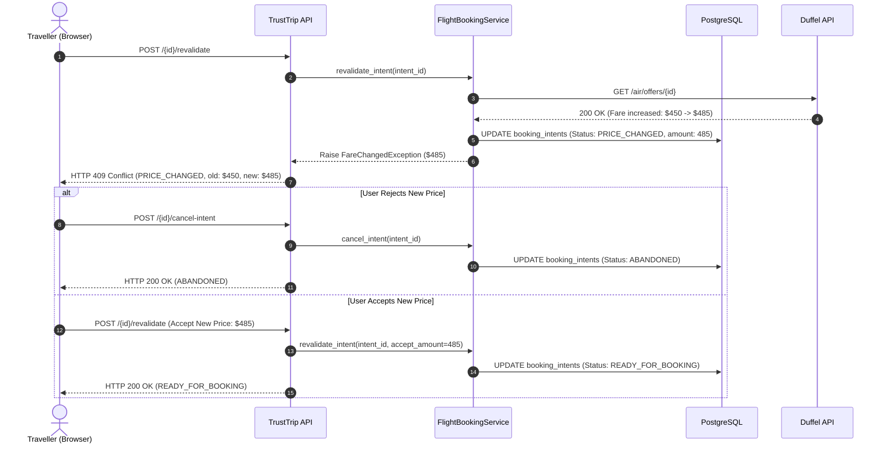

# TrustTrip — Phase 9 Gate 1 Architecture & Design
## Flight Booking & Duffel Lifecycle Architecture

**Scope:** Flight Booking Lifecycle, Duffel Links & API Ordering, State Machine, Revalidation, Idempotency, and Concurrency  
**Baseline:** Phase 8 = APPROVED / FROZEN / PUSHED (`feat: complete phase 8 global travel research & rag intelligence`)  
**Status:** Gate 1 Architecture & Design Specification (Zero Source-Code Modifications)  
**Deliverable File:** `PHASE_9_GATE_1_ARCHITECTURE.md`  

---

## 1. Executive Summary & Booking Boundary

### 1.1 Executive Summary
Phase 9 establishes an enterprise-grade, production-safe flight booking lifecycle around TrustTrip's existing live flight architecture (backed by the Duffel flight provider adapter). While Phases 4 through 7 established search, flexible date shopping, offer snapshotting, and pre-handoff revalidation, Phase 9 formalizes the complete end-to-end booking state machine, tenant-isolated booking intents, provider session handoffs, transactional locking, concurrency controls, and failure resilience.

All invariants established in Phases 1 through 8—including tenant isolation, append-only offer immutability, attach-once evidence provenance, parent-trip locking, optimistic revision concurrency, zero URL fabrication, and unbounded HITL replanning—are strictly preserved.

### 1.2 The Strict Booking Boundary: Flights vs Hotels
TrustTrip strictly segregates flight and hotel booking architectures due to distinct merchant-of-record, regulatory, ticketing, and supplier fulfillment requirements:

```
┌───────────────────────────────────────────────────────────────────────────────────────────┐
│                                   TRUSTTRIP PLATFORM                                      │
├─────────────────────────────────────────────────┬─────────────────────────────────────────┤
│               FLIGHT BOOKING LIFECYCLE          │         HOTEL BOOKING LIFECYCLE         │
├─────────────────────────────────────────────────┼─────────────────────────────────────────┤
│ 1. Search & Shopping (Duffel API)               │ 1. Search & Room Offers                 │
│ 2. Normalized Offer Display                     │ 2. Pre-book Verification                │
│ 3. Explicit User Selection                      │ 3. In-App Checkout Form (Holder/Guests) │
│ 4. Immutable Offer Snapshot (AES encrypted)     │ 4. Native Payment Order (Razorpay INR)  │
│ 5. Pre-Handoff Deep Revalidation Gate           │ 5. Native Payment Capture               │
│ 6. Authoritative BookingIntent (State Machine)  │ 6. Supplier Booking Fulfillment         │
│ 7. Provider Checkout Handoff (Duffel Links)     │ 7. Stored Transaction Record            │
│    OR Native Sandbox Order (Test Mode)          │    (trust_trip_hotel_transactions)      │
│ 8. Provider Lifecycle Tracking & Webhook Sync   │ 8. Stored PDF Voucher Generation        │
│                                                 │                                         │
│ * User completes payment on hosted Duffel Link  │ * User pays directly inside TrustTrip   │
│   checkout session or verified airline portal   │   via Razorpay gateway                  │
│ * TrustTrip does NOT collect flight card PII    │ * TrustTrip acts as merchant orchestrator│
└─────────────────────────────────────────────────┴─────────────────────────────────────────┘
```

#### Core Invariants of the Boundary:
1. **No Shared Transaction Records**: Flights use the dedicated `booking_intents` and `booking_attempts` tables. Hotels use `trust_trip_hotel_transactions`.
2. **No Shared Payment Paths**: Flight payments never route through TrustTrip's Razorpay gateway. TrustTrip never collects, touches, or stores credit card numbers, CVVs, or 3DS tokens for flights. All flight payment collection occurs either on Duffel's PCI-DSS Level 1 compliant hosted checkout (`Duffel Links`) or via verified airline direct portals.
3. **No Mixed State Machines**: Flight lifecycle transitions reflect IATA ticketing and airline inventory dynamics (`SELECTED`, `REVALIDATING`, `READY_FOR_BOOKING`, `HANDED_OFF`, `COMPLETED`, `ABANDONED`). Hotel states reflect direct payment capture and room reservation (`awaiting_payment`, `booking_in_progress`, `confirmed`).

---

## 2. Booking Domain Model

The flight booking domain model defines strongly typed, immutable entities that isolate TrustTrip's business logic from raw supplier formats. TrustTrip assigns and maintains its own authoritative identity for every booking intent. Provider IDs are references, never primary keys.

```
┌──────────────────────────────────────────────────────────────────────────────────┐
│                                   BookingIntent                                  │
├──────────────────────────────────────────────────────────────────────────────────┤
│ - id: UUID (PK)                                                                  │
│ - user_id: UUID (Tenant Anchor)                                                  │
│ - trip_id: UUID                                                                  │
│ - revision_id: UUID (Authoritative Plan Revision)                                │
│ - selected_offer_snapshot_id: UUID (Initial Frozen Offer)                        │
│ - current_revalidation_snapshot_id: UUID (Latest Revalidated Offer)              │
│ - provider: BookingProvider (DUFFEL, AMADEUS, TEST_STUB)                         │
│ - booking_mode: BookingMode (DUFFEL_LINK, DUFFEL_API_ORDER, AIRLINE_DIRECT)      │
│ - status: BookingStatus (DRAFT, SELECTED, REVALIDATING, etc.)                    │
│ - idempotency_key: str (Client Deduplication Key)                                │
│ - provider_reference: str | None (e.g. Duffel link ses_123 or ord_123)           │
│ - handoff_url: str | None (Verified Provider Checkout URL)                       │
│ - handoff_expires_at: datetime | None (TTL for the checkout link)                │
│ - passenger_hash: str (SHA-256 of passenger names, DOBs, passport refs)          │
│ - expected_amount: Decimal                                                       │
│ - currency: str (ISO-4217, 3 chars)                                              │
│ - created_at: datetime                                                           │
│ - updated_at: datetime                                                           │
│ - expires_at: datetime                                                           │
└──────────────────────────────────────────────────────────────────────────────────┘
```

### 2.1 Domain Enums and Data Models

```python
from __future__ import annotations

from datetime import datetime
from decimal import Decimal
from enum import StrEnum
from typing import Any
from uuid import UUID

from pydantic import BaseModel, ConfigDict, Field


class BookingProvider(StrEnum):
    """Supported upstream flight inventory and booking providers."""
    DUFFEL = "duffel"
    AMADEUS = "amadeus"
    TEST_STUB = "test_stub"


class BookingMode(StrEnum):
    """The checkout and ordering mode executed by the booking provider."""
    DUFFEL_LINK = "duffel_link"          # Provider-hosted checkout session (Production)
    DUFFEL_API_ORDER = "duffel_api_order"  # Direct API order (Sandbox balance or direct)
    DIRECT_AIRLINE_VERIFIED = "direct_airline_verified"  # Verified carrier URL handoff


class BookingStatus(StrEnum):
    """Formal lifecycle states of a TrustTrip flight booking intent."""
    DRAFT = "DRAFT"
    SELECTED = "SELECTED"
    REVALIDATING = "REVALIDATING"
    EXPIRED = "EXPIRED"
    PRICE_CHANGED = "PRICE_CHANGED"
    UNAVAILABLE = "UNAVAILABLE"
    READY_FOR_BOOKING = "READY_FOR_BOOKING"  # Synonymous with VALID
    HANDED_OFF = "HANDED_OFF"
    COMPLETED = "COMPLETED"
    FAILED = "FAILED"
    ABANDONED = "ABANDONED"


class BookingTransition(BaseModel):
    """Immutable audit entry recording a state machine transition."""
    model_config = ConfigDict(extra="forbid", frozen=True)

    transition_id: UUID
    intent_id: UUID
    from_status: BookingStatus
    to_status: BookingStatus
    trigger: str
    actor_id: UUID | str
    reason: str | None = None
    metadata: dict[str, Any] = Field(default_factory=dict)
    timestamp: datetime


class OfferRevalidationResult(BaseModel):
    """Detailed result of comparing authoritative snapshot with live provider offer."""
    model_config = ConfigDict(extra="forbid", frozen=True)

    is_valid: bool
    status: BookingStatus  # READY_FOR_BOOKING, PRICE_CHANGED, UNAVAILABLE, EXPIRED
    original_snapshot_id: UUID
    fresh_snapshot_id: UUID | None
    price_changed: bool
    original_amount: Decimal
    current_amount: Decimal
    currency: str
    divergent_fields: list[str] = Field(default_factory=list)
    revalidated_at: datetime
    details: str


class BookingIntent(BaseModel):
    """Authoritative TrustTrip flight booking intent entity."""
    model_config = ConfigDict(extra="forbid", frozen=True)

    id: UUID
    user_id: UUID
    trip_id: UUID
    revision_id: UUID
    selected_offer_snapshot_id: UUID
    current_revalidation_snapshot_id: UUID | None = None
    provider: BookingProvider
    booking_mode: BookingMode
    status: BookingStatus
    idempotency_key: str
    provider_reference: str | None = None
    handoff_url: str | None = None
    handoff_expires_at: datetime | None = None
    passenger_hash: str
    expected_amount: Decimal
    currency: str
    created_at: datetime
    updated_at: datetime
    expires_at: datetime
```

---

## 3. Booking State Machine

### 3.1 State Definitions
The state machine strictly governs the life of every `BookingIntent`. Every transition is explicit, guarded by preconditions, audited in `booking_transitions`, and protected against race conditions.

| State | Semantic Meaning | Terminal? | User Action Allowed? |
| :--- | :--- | :---: | :---: |
| **`DRAFT`** | Initial intent initialized with flight selection criteria before snapshot binding. | No | Yes (Cancel) |
| **`SELECTED`** | Valid snapshot bound to tenant, trip, and published plan revision. | No | Yes (Revalidate, Cancel) |
| **`REVALIDATING`** | Active live verification call with supplier provider is in-flight. | No | No (Locked) |
| **`EXPIRED`** | Supplier offer TTL or intent handoff deadline elapsed. | **Yes** | No (Must restart) |
| **`PRICE_CHANGED`** | Supplier verified inventory exists, but price or currency has changed. | No | Yes (Acknowledge, Cancel) |
| **`UNAVAILABLE`** | Supplier reports flight sold out, withdrawn, or cancelled. | **Yes** | No (Must pick another) |
| **`READY_FOR_BOOKING`**| Offer revalidated unchanged (or price change acknowledged). Fresh snapshot produced. | No | Yes (Initiate Handoff) |
| **`HANDED_OFF`** | Provider checkout link generated & dispatched to client; awaiting user checkout. | No | Yes (Poll, Abandon) |
| **`COMPLETED`** | Provider order confirmed, PNR/e-ticket issued, lifecycle successful. | **Yes** | No (Read-only) |
| **`FAILED`** | Upstream provider error, payment failure, or internal handoff exception. | **Yes** | No (Read-only) |
| **`ABANDONED`** | User explicitly cancelled intent, or handoff session expired without checkout. | **Yes** | No (Read-only) |

### 3.2 Formal State Transition Diagram



### 3.3 Legal Transition Matrix & Fail-Closed Guard

Any transition attempt not explicitly defined in the table below is **ILLEGAL** and must **fail closed** by throwing `InvalidBookingStateTransitionError` without modifying database state:

| From State | Permitted Target States | Trigger / Condition |
| :--- | :--- | :--- |
| `DRAFT` | `SELECTED`, `ABANDONED` | Offer snapshot bound / user abort |
| `SELECTED` | `REVALIDATING`, `ABANDONED`, `EXPIRED` | Revalidation requested / user cancel / HITL revision bump |
| `REVALIDATING` | `READY_FOR_BOOKING`, `PRICE_CHANGED`, `UNAVAILABLE`, `EXPIRED`, `FAILED` | Revalidation outcome from supplier port |
| `PRICE_CHANGED` | `SELECTED`, `ABANDONED` | User accepts new price / user rejects |
| `READY_FOR_BOOKING` | `HANDED_OFF`, `REVALIDATING`, `ABANDONED`, `EXPIRED` | Handoff requested / TTL timeout / cancel / HITL revision bump |
| `HANDED_OFF` | `COMPLETED`, `FAILED`, `ABANDONED` | Webhook confirmation / Webhook failure / checkout session expired |
| `EXPIRED` | *(None — Terminal)* | Fail closed |
| `UNAVAILABLE` | *(None — Terminal)* | Fail closed |
| `COMPLETED` | *(None — Terminal)* | Fail closed |
| `FAILED` | *(None — Terminal)* | Fail closed |
| `ABANDONED` | *(None — Terminal)* | Fail closed |

---

## 4. Offer Revalidation Architecture

### 4.1 Revalidation Contract
Before any booking handoff or order creation can occur, TrustTrip executes an unconditional pre-handoff revalidation gate. A stale offer **MUST NEVER SILENTLY CONTINUE**.

```
Client Handoff Request (intent_id)
             │
             ▼
┌────────────────────────────────────────────────────────┐
│ 1. TENANCY & REVISION GUARD                            │
│    - Authenticate user_id = trip.user_id               │
│    - Verify trip.current_revision_id = intent.revision │
│    - Verify snapshot belongs to trip & user            │
└────────────────────────────┬───────────────────────────┘
                             │
                             ▼
┌────────────────────────────────────────────────────────┐
│ 2. PROVIDER STATE RETRIEVAL                            │
│    - Fetch live offer from Duffel API (GET /offers/id) │
│    - Enforce provider call timeout (15s)               │
└────────────────────────────┬───────────────────────────┘
                             │
                             ▼
┌────────────────────────────────────────────────────────┐
│ 3. CRITICAL FIELD COMPARISON                           │
│    - Origin, Destination, Dates, Passenger Count,      │
│      Cabin Class, Baggage, Amount, Currency            │
└────────────────────────────┬───────────────────────────┘
                             │
            ┌────────────────┴────────────────┐
     Fields Match                      Field Divergence
            │                                 │
            ▼                                 ▼
┌───────────────────────────┐   ┌───────────────────────────┐
│ Create Fresh Successor    │   │ Price Delta:              │
│ OfferSnapshot (New ID)    │   │   -> Status: PRICE_CHANGED│
│ Bind to Intent            │   │ Inventory Sold Out:       │
│ Status: READY_FOR_BOOKING │   │   -> Status: UNAVAILABLE  │
└───────────────────────────┘   │ Route/Date Changed:       │
                                │   -> Status: UNAVAILABLE  │
                                └───────────────────────────┘
```

### 4.2 Critical Field Comparison Rules
The deep revalidation algorithm evaluates eight critical fields between the stored `OfferSnapshot` and the fresh provider offer response:

1. **`offer_id`**: Supplier offer reference must match the expected supplier ID.
2. **`origin`**: Origin airport IATA code across all slices must match exactly.
3. **`destination`**: Destination airport IATA code across all slices must match exactly.
4. **`dates`**: Departure and arrival timestamps must match within a 15-minute operational schedule window. Any schedule change $> 15\text{ minutes}$ is flagged as a schedule divergence.
5. **`passenger_composition`**: Total passenger count and passenger types (`adult`, `child`, `infant_without_seat`) must match exactly.
6. **`amount`**: Authoritative total fare (`base_amount + tax_amount`). Any difference $> 0.01$ units in the provider's currency transitions the intent to `PRICE_CHANGED`.
7. **`currency`**: The ISO-4217 currency code must match identically.
8. **`cabin_class`**: Cabin grade (`economy`, `premium_economy`, `business`, `first`) and branded fare features must be preserved.

### 4.3 Successor Snapshot Generation
When revalidation succeeds (or a user accepts an updated price):
- TrustTrip creates a brand new, immutable `OfferSnapshot` record in PostgreSQL.
- The new snapshot records `predecessor_snapshot_id = original_snapshot.id`.
- The `booking_intents.current_revalidation_snapshot_id` pointer is updated to the fresh snapshot.
- Raw supplier payload is scrubbed of PII and encrypted via AES-256-GCM before storage.
- The previous snapshot remains immutable in the database for auditing and provenance.

---

## 5. HITL (Human-in-the-Loop) Integration & Invalidation

### 5.1 The Authoritative Revision Lock
In TrustTrip, travel requirements (destinations, dates, passenger counts, budget) are governed by published `plan_revisions`. Every `BookingIntent` is permanently locked to a specific `revision_id`.

```
Plan Revision N (Current)  ────────────────► BookingIntent (Valid, revision_id = N)
           │
           │  User modifies travel date / route in chat (HITL)
           ▼
Plan Revision N + 1 (Published)
           │
           ├───────────────────────────────► Previous BookingIntent INVALIDATED (EXPIRED)
           │
           └───────────────────────────────► New BookingIntent Required (revision_id = N + 1)
```

### 5.2 Dependency-Aware Invalidation Rules
1. **Invalidating Mutations**: Any user interaction or planner refinement that modifies:
   - Origin or Destination airports/cities
   - Departure or Return dates
   - Passenger count or passenger passenger age brackets
   - Explicit flight replacement
   **AUTOMATICALLY INVALIDATES** all non-terminal `BookingIntent` records associated with previous revisions of that trip.
2. **Automatic Transition**: Invalidation immediately transitions the previous `BookingIntent` from `SELECTED`, `REVALIDATING`, or `READY_FOR_BOOKING` to `EXPIRED` with reason `REVISION_SUPERSEDED`.
3. **Safe Non-Invalidating Edits**: Modifications that affect only non-flight aspects of the trip (such as adding a restaurant, updating a day-3 museum activity, or selecting a hotel room) do **NOT** invalidate the flight `BookingIntent`, provided the trip's flight slice dates and passenger count remain unchanged.
4. **Enforcement via PostgreSQL Trigger**: A database trigger on `trips` updates (`BEFORE UPDATE OF current_revision_id`) automatically invalidates unhanded-off flight intents for that trip:

```sql
-- Conceptual trigger enforcement
CREATE OR REPLACE FUNCTION fn_invalidate_intents_on_revision_change()
RETURNS TRIGGER AS $$
BEGIN
    IF OLD.current_revision_id IS DISTINCT FROM NEW.current_revision_id THEN
        UPDATE booking_intents
        SET status = 'EXPIRED',
            updated_at = now()
        WHERE trip_id = NEW.id
          AND revision_id = OLD.current_revision_id
          AND status IN ('DRAFT', 'SELECTED', 'REVALIDATING', 'PRICE_CHANGED', 'READY_FOR_BOOKING');
    END IF;
    RETURN NEW;
END;
$$ LANGUAGE plpgsql;
```

---

## 6. Idempotency & Concurrency Model

Flight booking is vulnerable to distributed failure modes: user double-clicks, browser network retries, duplicate automated requests, and concurrent workers. A duplicate provider order could result in double-ticketing and unauthorized charges.

```
Request 1 (Idempotency-Key: "k-1") ──┐
                                     ├──► PostgreSQL SELECT FOR UPDATE (Locks Intent Row)
Request 2 (Idempotency-Key: "k-1") ──┘       │
(Duplicate retry)                            ├─► Request 1 processes: state advances
                                             └─► Request 2 waits: receives cached response
```

### 6.1 Idempotency Key Semantics
- Every mutating request (`/prepare`, `/revalidate`, `/handoff`, `/cancel-intent`) requires an `Idempotency-Key` header (UUIDv4 or client-minted monotonic token).
- TrustTrip tracks idempotency in a dedicated `booking_attempts` table with a unique constraint on `(user_id, idempotency_key)`.
- If a request arrives with an already-processed `idempotency_key`, the server returns the cached response with the HTTP header `X-Cache-Lookup: HIT` without re-executing any upstream provider calls.
- If a request with the same key is currently running, subsequent requests block on the database row lock until the leader completes, then return the recorded outcome.

### 6.2 PostgreSQL Transactional Locking
To ensure two distributed backend workers cannot process the same intent simultaneously:
1. **Row-Level Lock**: Every mutation begins with:
   ```sql
   SELECT * FROM booking_intents 
   WHERE id = :intent_id AND user_id = :user_id 
   FOR UPDATE;
   ```
2. **Compare-And-Set (CAS) State Transitions**: State advances use conditional SQL predicates:
   ```sql
   UPDATE booking_intents
   SET status = 'REVALIDATING', updated_at = now()
   WHERE id = :intent_id 
     AND status = 'SELECTED'
   RETURNING id;
   ```
   If the update returns zero rows, the intent has already been transitioned by another worker; the transaction aborts with HTTP 409 Conflict (`BOOKING_ALREADY_IN_PROGRESS`).

### 6.3 Provider Deduplication
When dispatching requests to Duffel:
- TrustTrip passes the `booking_intent.id` as Duffel's client reference and metadata tag.
- Duffel's API rejects duplicate order requests for the same offer. TrustTrip also queries `find_order_by_offer` before raising an error on ambiguous timeout responses.

---

## 7. URL & Handoff Security Architecture

### 7.1 Zero URL Fabrication Invariant (INV-10)
Under NO circumstances will TrustTrip fabricate, guess, or construct flight booking or payment URLs. Fabricated URLs expose travellers to phishing, broken booking flows, and incorrect tariff bindings.

### 7.2 Taxonomy of Booking Destinations
TrustTrip strictly distinguishes between four destination classes:

```
┌─────────────────────────────────────────────────────────────────────────────────┐
│                                DESTINATION TAXONOMY                             │
├──────────────────────────┬──────────────────────────────────────────────────────┤
│ Class                    │ Architectural Policy & Behavior                      │
├──────────────────────────┼──────────────────────────────────────────────────────┤
│ 1. Duffel Links          │ PRIMARY PRODUCTION MODE. Generated via Duffel's      │
│    (Hosted Checkout)     │ server-side Links API (`POST /air/links`).           │
│                          │ Hostname must strictly end with `.duffel.link` or    │
│                          │ `.duffel.com`. Returned session token stored.        │
├──────────────────────────┼──────────────────────────────────────────────────────┤
│ 2. Duffel API Direct     │ SANDBOX DEMO / ENTERPRISE MODE. Order created        │
│    (Server-to-Server)    │ directly via `POST /air/orders`. Instant sandbox     │
│                          │ balance payment; no external URL needed.             │
├──────────────────────────┼──────────────────────────────────────────────────────┤
│ 3. Verified Carrier Site │ SECONDARY FALLBACK. Official carrier checkout URL    │
│    (Direct Airline)      │ supplied in supplier payload. Hostname MUST match    │
│                          │ server-side `CARRIER_DOMAIN_ALLOWLIST`.              │
├──────────────────────────┼──────────────────────────────────────────────────────┤
│ 4. Generic External URL  │ STRICTLY FORBIDDEN. Untrusted, non-allowlisted,      │
│                          │ or LLM-generated URLs are rejected immediately.      │
└──────────────────────────┴──────────────────────────────────────────────────────┘
```

### 7.3 Duffel Links Architecture & Integration
TrustTrip implements **Duffel Links** as its standard production flight checkout experience:
1. **Link Session Creation**: Server calls Duffel Links API:
   ```json
   POST https://api.duffel.com/air/links
   {
     "data": {
       "selected_offers": ["off_0000Axxx"],
       "passengers": [
         {
           "id": "pas_0000Ayyy",
           "given_name": "Supratik",
           "family_name": "Mukherjee",
           "born_on": "1995-05-12",
           "gender": "m",
           "title": "mr",
           "email": "user@trusttrip.com",
           "phone_number": "+919876543210"
         }
       ],
       "success_url": "https://trusttrip.com/bookings/flight/callback?intent_id={intent_id}&status=success",
       "failure_url": "https://trusttrip.com/bookings/flight/callback?intent_id={intent_id}&status=failure",
       "abandonment_url": "https://trusttrip.com/bookings/flight/callback?intent_id={intent_id}&status=abandoned"
     }
   }
   ```
2. **Reference Storage**: The returned session ID (`ses_...`) and checkout URL are stored in `booking_intents.provider_reference` and `booking_intents.handoff_url`.
3. **URL Validation**: Before persisting or returning to the browser, the URL passes through `_validate_and_normalize_url` and `_is_approved_duffel_host`. Any IP literal, HTTP scheme, userinfo injection, or domain spoofing aborts with an internal security error.
4. **Configured Redirect Destinations**: All callback URLs use server-configured domain settings (`TRUSTTRIP_PUBLIC_BASE_URL`); clients cannot supply arbitrary redirect parameters.

---

## 8. Booking Provider Port Abstraction

The core domain remains strictly decoupled from Duffel-specific data schemas. Upstream flight operations are accessed exclusively through `FlightBookingProviderPort`.

```
┌────────────────────────────────────────────────────────┐
│                   TrustTrip Domain                     │
│         (FlightBookingService, PlannerService)         │
└───────────────────────────┬────────────────────────────┘
                            │
                            ▼
┌────────────────────────────────────────────────────────┐
│               FlightBookingProviderPort                │
│                      (Protocol)                        │
├────────────────────────────────────────────────────────┤
│ + revalidate_offer(provider_offer_id, ...)             │
│ + create_handoff_session(offer_id, passengers, ...)    │
│ + create_api_order(offer_id, passengers, payment, ...) │
│ + get_order(order_id)                                  │
│ + cancel_order(order_id)                               │
└───────────────────────────┬────────────────────────────┘
                            │
             ┌──────────────┴──────────────┐
             ▼                             ▼
┌──────────────────────────┐  ┌──────────────────────────┐
│   DuffelBookingAdapter   │  │   StubBookingAdapter     │
│ (Production / Sandbox)   │  │    (Unit / Mock Tests)   │
└──────────────────────────┘  └──────────────────────────┘
```

### 8.1 Port Definition

```python
from typing import Any, Protocol
from decimal import Decimal
from domain.booking import BookingMode
from domain.live_offer import RevalidationResult


class FlightBookingProviderPort(Protocol):
    """Abstract provider port for flight revalidation, handoff, and ordering."""

    @property
    def provider_name(self) -> str:
        """Name of the provider (e.g. 'duffel')."""
        ...

    async def revalidate_offer(
        self,
        provider_offer_id: str,
        expected_price: Decimal | None = None,
        expected_currency: str | None = None,
        call_timeout: float = 15.0,
    ) -> RevalidationResult:
        """Verify live availability and price for a supplier offer."""
        ...

    async def create_handoff_session(
        self,
        provider_offer_id: str,
        passengers: list[dict[str, Any]],
        success_url: str,
        failure_url: str,
        abandonment_url: str,
        call_timeout: float = 20.0,
    ) -> dict[str, Any]:
        """Create a hosted checkout session (e.g. Duffel Links).

        Returns: {'handoff_url': str, 'provider_reference': str, 'expires_at': datetime}
        """
        ...

    async def create_api_order(
        self,
        provider_offer_id: str,
        passengers: list[dict[str, Any]],
        payment_mode: str,
        payment_details: dict[str, Any] | None = None,
        call_timeout: float = 60.0,
    ) -> dict[str, Any]:
        """Execute a direct API order creation."""
        ...

    async def get_order_status(
        self,
        provider_order_id: str,
        call_timeout: float = 15.0,
    ) -> dict[str, Any]:
        """Fetch current order, ticketing, and PNR status."""
        ...
```

---

## 9. Database Design & Migration Specification

### 9.1 Relational Architecture
The database schema introduces three new tables, maintains full tenant and revision referential integrity, and incorporates PostgreSQL immutability and transition triggers.

```
trips (id, user_id)
  ▲
  │ 1 : N
plan_revisions (revision_id, trip_id, user_id)
  ▲
  │ 1 : N
booking_intents ──────────────────────────┐ 1 : N
  │ (id, user_id, trip_id, revision_id)    ▼
  │                               booking_transitions
  │ 1 : N                         (audit history)
  ▼
booking_attempts 
(idempotency & retry tracking)
```

### 9.2 SQL Migration DDL (`007_flight_booking_lifecycle.sql`)

```sql
-- Migration: 007_flight_booking_lifecycle.sql
-- Description: Flight booking intents, attempts, transitions, and state machine triggers.

-- ========================================================
-- PART 1: ENUMS
-- ========================================================
DO $$
BEGIN
    IF NOT EXISTS (SELECT 1 FROM pg_type WHERE typname = 'booking_provider_enum') THEN
        CREATE TYPE booking_provider_enum AS ENUM ('duffel', 'amadeus', 'test_stub');
    END IF;

    IF NOT EXISTS (SELECT 1 FROM pg_type WHERE typname = 'booking_mode_enum') THEN
        CREATE TYPE booking_mode_enum AS ENUM ('duffel_link', 'duffel_api_order', 'direct_airline_verified');
    END IF;

    IF NOT EXISTS (SELECT 1 FROM pg_type WHERE typname = 'booking_status_enum') THEN
        CREATE TYPE booking_status_enum AS ENUM (
            'DRAFT', 'SELECTED', 'REVALIDATING', 'EXPIRED', 'PRICE_CHANGED',
            'UNAVAILABLE', 'READY_FOR_BOOKING', 'HANDED_OFF', 'COMPLETED',
            'FAILED', 'ABANDONED'
        );
    END IF;
END$$;

-- ========================================================
-- PART 2: CORE BOOKING INTENTS TABLE
-- ========================================================
CREATE TABLE IF NOT EXISTS booking_intents (
    id UUID PRIMARY KEY DEFAULT gen_random_uuid(),
    user_id UUID NOT NULL,
    trip_id UUID NOT NULL,
    revision_id UUID NOT NULL,
    selected_offer_snapshot_id UUID NOT NULL,
    current_revalidation_snapshot_id UUID NULL,
    provider booking_provider_enum NOT NULL DEFAULT 'duffel',
    booking_mode booking_mode_enum NOT NULL DEFAULT 'duffel_link',
    status booking_status_enum NOT NULL DEFAULT 'DRAFT',
    idempotency_key VARCHAR(128) NOT NULL,
    provider_reference VARCHAR(128) NULL,
    handoff_url TEXT NULL,
    handoff_expires_at TIMESTAMPTZ NULL,
    passenger_hash VARCHAR(64) NOT NULL,
    expected_amount NUMERIC(12, 2) NOT NULL,
    currency VARCHAR(3) NOT NULL,
    metadata JSONB NOT NULL DEFAULT '{}'::jsonb,
    created_at TIMESTAMPTZ NOT NULL DEFAULT now(),
    updated_at TIMESTAMPTZ NOT NULL DEFAULT now(),
    expires_at TIMESTAMPTZ NOT NULL,

    -- Multi-column tenancy foreign keys
    CONSTRAINT fk_booking_intents_trip_user FOREIGN KEY (trip_id, user_id)
        REFERENCES trips(id, user_id) ON DELETE CASCADE,
    CONSTRAINT fk_booking_intents_revision FOREIGN KEY (revision_id, trip_id, user_id)
        REFERENCES plan_revisions(revision_id, trip_id, user_id) ON DELETE CASCADE,
    CONSTRAINT fk_booking_intents_selected_snapshot FOREIGN KEY (selected_offer_snapshot_id)
        REFERENCES offer_snapshots(id) ON DELETE RESTRICT,
    CONSTRAINT fk_booking_intents_reval_snapshot FOREIGN KEY (current_revalidation_snapshot_id)
        REFERENCES offer_snapshots(id) ON DELETE SET NULL,

    -- Composite unique constraints
    CONSTRAINT uq_booking_intents_composite UNIQUE (id, user_id, trip_id),
    CONSTRAINT uq_booking_intents_user_idempotency UNIQUE (user_id, idempotency_key),
    CONSTRAINT chk_positive_amount CHECK (expected_amount >= 0)
);

-- Indexes for high-performance query execution
CREATE INDEX IF NOT EXISTS idx_booking_intents_lookup 
    ON booking_intents (user_id, trip_id, status);
CREATE INDEX IF NOT EXISTS idx_booking_intents_provider_ref 
    ON booking_intents (provider, provider_reference) WHERE provider_reference IS NOT NULL;
CREATE INDEX IF NOT EXISTS idx_booking_intents_expiry 
    ON booking_intents (status, expires_at);

-- ========================================================
-- PART 3: BOOKING ATTEMPTS (IDEMPOTENCY & AUDIT)
-- ========================================================
CREATE TABLE IF NOT EXISTS booking_attempts (
    attempt_id UUID PRIMARY KEY DEFAULT gen_random_uuid(),
    intent_id UUID NOT NULL,
    user_id UUID NOT NULL,
    idempotency_key VARCHAR(128) NOT NULL,
    action VARCHAR(32) NOT NULL,
    attempt_number INT NOT NULL DEFAULT 1,
    status VARCHAR(32) NOT NULL,
    request_payload JSONB NULL,
    response_payload JSONB NULL,
    error_code VARCHAR(64) NULL,
    created_at TIMESTAMPTZ NOT NULL DEFAULT now(),

    CONSTRAINT fk_booking_attempts_intent FOREIGN KEY (intent_id)
        REFERENCES booking_intents(id) ON DELETE CASCADE,
    CONSTRAINT uq_attempts_user_key_action UNIQUE (user_id, idempotency_key, action)
);

CREATE INDEX IF NOT EXISTS idx_booking_attempts_intent 
    ON booking_attempts (intent_id, created_at DESC);

-- ========================================================
-- PART 4: BOOKING TRANSITIONS (IMMUTABLE STATE AUDIT)
-- ========================================================
CREATE TABLE IF NOT EXISTS booking_transitions (
    transition_id UUID PRIMARY KEY DEFAULT gen_random_uuid(),
    intent_id UUID NOT NULL,
    from_status booking_status_enum NOT NULL,
    to_status booking_status_enum NOT NULL,
    trigger VARCHAR(64) NOT NULL,
    actor_id VARCHAR(64) NOT NULL,
    reason TEXT NULL,
    metadata JSONB NOT NULL DEFAULT '{}'::jsonb,
    created_at TIMESTAMPTZ NOT NULL DEFAULT now(),

    CONSTRAINT fk_booking_transitions_intent FOREIGN KEY (intent_id)
        REFERENCES booking_intents(id) ON DELETE CASCADE
);

CREATE INDEX IF NOT EXISTS idx_booking_transitions_intent 
    ON booking_transitions (intent_id, created_at ASC);

-- ========================================================
-- PART 5: IMMUTABILITY & LIFECYCLE TRIGGERS
-- ========================================================

-- Freeze tenancy identity on booking_intents
CREATE OR REPLACE FUNCTION fn_freeze_booking_intent_identity()
RETURNS TRIGGER AS $$
BEGIN
    IF OLD.user_id != NEW.user_id OR OLD.trip_id != NEW.trip_id OR OLD.revision_id != NEW.revision_id THEN
        RAISE EXCEPTION 'booking_intent tenancy and revision identity (user_id, trip_id, revision_id) is immutable'
            USING ERRCODE = 'restrict_violation';
    END IF;
    RETURN NEW;
END;
$$ LANGUAGE plpgsql;

DROP TRIGGER IF EXISTS trg_freeze_booking_intent_identity ON booking_intents;
CREATE TRIGGER trg_freeze_booking_intent_identity
    BEFORE UPDATE OF user_id, trip_id, revision_id ON booking_intents
    FOR EACH ROW
    EXECUTE FUNCTION fn_freeze_booking_intent_identity();

-- Audit state transitions automatically
CREATE OR REPLACE FUNCTION fn_audit_booking_transition()
RETURNS TRIGGER AS $$
BEGIN
    IF OLD.status != NEW.status THEN
        INSERT INTO booking_transitions (
            intent_id, from_status, to_status, trigger, actor_id, reason, metadata
        ) VALUES (
            NEW.id, OLD.status, NEW.status, 'STATE_UPDATE', NEW.user_id::text,
            'Automated transition', jsonb_build_object('updated_at', NEW.updated_at)
        );
    END IF;
    RETURN NEW;
END;
$$ LANGUAGE plpgsql;

DROP TRIGGER IF EXISTS trg_audit_booking_transition ON booking_intents;
CREATE TRIGGER trg_audit_booking_transition
    AFTER UPDATE OF status ON booking_intents
    FOR EACH ROW
    EXECUTE FUNCTION fn_audit_booking_transition();
```

---

## 10. Structured Error Model

TrustTrip enforces a structured, machine-readable error architecture. Upstream supplier errors (e.g. Duffel HTTP 500, HTML responses, socket dropouts) are intercepted at the adapter layer and mapped to stable domain exceptions. Raw provider credentials, tokens, and internals are NEVER exposed to browser clients.

### 10.1 Domain Error Taxonomy

| Error Code | HTTP Status | Domain Exception | Client Message | Actionable Resolution |
| :--- | :---: | :--- | :--- | :--- |
| **`OFFER_EXPIRED`** | 410 | `OfferExpiredException` | The selected flight offer has expired. | Re-run flight search to fetch current inventory. |
| **`OFFER_CHANGED`** | 409 | `OfferChangedException` | Flight schedule or cabin details changed. | Review updated schedule and re-confirm selection. |
| **`PRICE_CHANGED`** | 409 | `FareChangedException` | Flight fare has changed from supplier. | Accept updated price or choose an alternative flight. |
| **`OFFER_UNAVAILABLE`**| 410 | `OfferUnavailableException` | The selected flight is no longer available. | Select another flight option from current search. |
| **`REVISION_STALE`** | 409 | `StaleRevisionException` | Trip requirements modified since selection. | Refresh plan revision and create a fresh booking intent. |
| **`BOOKING_ALREADY_IN_PROGRESS`** | 409 | `BookingLockedException` | A booking operation is currently in progress. | Wait for ongoing operation to complete. |
| **`BOOKING_ALREADY_COMPLETED`** | 409 | `BookingCompletedException`| This booking has already been completed. | View your confirmed booking details in the trip itinerary. |
| **`PROVIDER_TIMEOUT`** | 504 | `FlightProviderTimeout` | Upstream airline system timed out. | Retry operation using the same idempotency key. |
| **`PROVIDER_UNAVAILABLE`** | 502 | `FlightProviderError` | Flight booking service temporarily unavailable. | Please try again in a few moments. |
| **`INVALID_BOOKING_STATE`** | 400 | `InvalidBookingStateTransitionError` | Requested action is invalid for current state. | Refresh booking status. |
| **`OWNERSHIP_VIOLATION`** | 403 | `PermissionError` | Access denied for this booking resource. | Authenticate with the correct account. |

### 10.2 Structured Error Envelope Format
When an exception occurs, the HTTP API emits a standardized JSON envelope:

```json
{
  "success": false,
  "error": {
    "code": "PRICE_CHANGED",
    "message": "Flight fare updated by supplier from USD 450.00 to USD 485.00.",
    "details": {
      "intent_id": "3fa85f64-5717-4562-b3fc-2c963f66afa6",
      "original_amount": "450.00",
      "new_amount": "485.00",
      "currency": "USD",
      "subsequent_snapshot_id": "8bb38f21-7212-4211-b11a-1c863f66bbb2"
    }
  }
}
```

---

## 11. API Surface

The proposed endpoints replace ad-hoc endpoints with a clean, RESTful lifecycle contract under `/api/bookings/flight`:

```
POST   /api/bookings/flight/prepare           ── Create/bind BookingIntent (Status: SELECTED)
POST   /api/bookings/flight/{id}/revalidate   ── Revalidate against live supplier
POST   /api/bookings/flight/{id}/handoff      ── Initiate Duffel Links or verified checkout
GET    /api/bookings/{id}                     ── Query authoritative booking lifecycle status
POST   /api/bookings/{id}/cancel-intent       ── Cancel / abandon intent
```

### 11.1 Endpoints Specification

#### 1. Prepare Flight Booking
`POST /api/bookings/flight/prepare`  
Creates a new `BookingIntent` bound to the user's active trip and authoritative published revision.

*Request Headers:*  
`Authorization: Bearer <jwt>`  
`Idempotency-Key: <uuid>`  

*Request Body:*
```json
{
  "trip_id": "9a38f321-7711-4777-a888-123456789abc",
  "snapshot_id": "c1a2b3c4-d5e6-7f8a-9b0c-1d2e3f4a5b6c",
  "passengers": [
    {
      "given_name": "Supratik",
      "family_name": "Mukherjee",
      "born_on": "1995-05-12",
      "gender": "m",
      "title": "mr",
      "email": "supratik@trusttrip.com",
      "phone_number": "+919876543210"
    }
  ]
}
```

*Response (HTTP 201 Created):*
```json
{
  "intent_id": "7b881234-abcd-ef01-2345-6789abcdef01",
  "status": "SELECTED",
  "trip_id": "9a38f321-7711-4777-a888-123456789abc",
  "revision_id": "f5e4d3c2-b1a0-9876-5432-10fedcba9876",
  "snapshot_id": "c1a2b3c4-d5e6-7f8a-9b0c-1d2e3f4a5b6c",
  "expected_amount": "450.00",
  "currency": "USD",
  "expires_at": "2026-09-24T12:00:00Z"
}
```

#### 2. Revalidate Flight Booking
`POST /api/bookings/flight/{id}/revalidate`  
Executes deep comparison against the upstream provider. Updates intent to `READY_FOR_BOOKING` or `PRICE_CHANGED`.

*Response (HTTP 200 OK — Ready):*
```json
{
  "intent_id": "7b881234-abcd-ef01-2345-6789abcdef01",
  "status": "READY_FOR_BOOKING",
  "is_valid": true,
  "original_snapshot_id": "c1a2b3c4-d5e6-7f8a-9b0c-1d2e3f4a5b6c",
  "fresh_snapshot_id": "e9f8a7b6-c5d4-3e2f-1a0b-c9d8e7f6a5b4",
  "amount": "450.00",
  "currency": "USD",
  "revalidated_at": "2026-09-24T11:45:00Z"
}
```

#### 3. Initiate Flight Handoff
`POST /api/bookings/flight/{id}/handoff`  
Generates a verified Duffel Links session or resolves direct carrier checkout destination.

*Request Body:*
```json
{
  "booking_mode": "duffel_link",
  "accepted_amount": "450.00"
}
```

*Response (HTTP 200 OK — Handed Off):*
```json
{
  "intent_id": "7b881234-abcd-ef01-2345-6789abcdef01",
  "status": "HANDED_OFF",
  "booking_mode": "duffel_link",
  "redirect_url": "https://links.duffel.com/pay/ses_0000AbCdEf123456",
  "provider_reference": "ses_0000AbCdEf123456",
  "handoff_expires_at": "2026-09-24T12:15:00Z",
  "instructions": "You are being redirected to TrustTrip's flight checkout partner, Duffel, to complete your secure ticket booking."
}
```

#### 4. Get Booking Status
`GET /api/bookings/{id}`  
Returns authoritative intent state, timestamps, and order references.

#### 5. Cancel Booking Intent
`POST /api/bookings/{id}/cancel-intent`  
Explicitly cancels an uncompleted intent, transitioning state to `ABANDONED`.

---

## 12. Sequence Diagrams

### 12.1 End-to-End Flight Booking Flow (Duffel Links)



### 12.2 Price Change Rejection & Invalidation Sequence



---

## 13. Comprehensive Testing Strategy

A production-grade test suite must be implemented in Gate 2 across unit, service, integration, and security layers.

### 13.1 Test Matrix

```
┌────────────────────────────────────────────────────────────────────────────────────────┐
│                                   TEST MATRIX                                          │
├────────────────────────┬───────────────────────────────────────────────────────────────┤
│ Test Category          │ Invariants & Test Scenarios Covered                           │
├────────────────────────┼───────────────────────────────────────────────────────────────┤
│ 1. Ownership & Tenancy │ * Attempting to access or prepare intent for another user's   │
│                        │   trip returns HTTP 403 / PermissionError.                    │
│                        │ * Cross-tenant snapshot binding fails closed.                 │
├────────────────────────┼───────────────────────────────────────────────────────────────┤
│ 2. Revision Guard      │ * Preparing or revalidating an intent against a non-current   │
│                        │   revision returns HTTP 409 REVISION_STALE.                   │
│                        │ * Database foreign key restricts orphans.                     │
├────────────────────────┼───────────────────────────────────────────────────────────────┤
│ 3. Deep Revalidation   │ * Stale price triggers 409 PRICE_CHANGED with exact diff.     │
│                        │ * Sold-out inventory triggers 410 OFFER_UNAVAILABLE.          │
│                        │ * Expired offer triggers 410 OFFER_EXPIRED.                   │
│                        │ * Origin/destination/passenger mismatch aborts revalidation.  │
│                        │ * Success produces new immutable OfferSnapshot successor.     │
├────────────────────────┼───────────────────────────────────────────────────────────────┤
│ 4. State Machine       │ * All legal transitions succeed and log to audit table.       │
│                        │ * Every illegal transition (e.g. DRAFT -> COMPLETED) raises   │
│                        │   InvalidBookingStateTransitionError and aborts.              │
│                        │ * Terminal states (COMPLETED, FAILED, ABANDONED) accept no    │
│                        │   subsequent transitions.                                     │
├────────────────────────┼───────────────────────────────────────────────────────────────┤
│ 5. Concurrency & Locks │ * Rapid double-click with identical Idempotency-Key returns   │
│                        │   cached response without duplicate provider link creation.   │
│                        │ * Concurrent worker competition: SELECT FOR UPDATE serializes │
│                        │   state transitions; losing worker fails cleanly.             │
├────────────────────────┼───────────────────────────────────────────────────────────────┤
│ 6. HITL Invalidation   │ * Trip revision bump (e.g. changing dates in chat) causes     │
│                        │   all active BookingIntents to transition to EXPIRED.         │
│                        │ * Hotel-only edits leave active flight intent intact.         │
├────────────────────────┼───────────────────────────────────────────────────────────────┤
│ 7. URL Security        │ * Zero URL fabrication: no arbitrary or mock URLs returned.   │
│                        │ * Duffel Link host validation: only verified duffel domains.  │
│                        │ * Direct carrier allowlist: only approved IATA airline sites. │
│                        │ * SSRF, IP literals, and loopback redirects rejected.         │
├────────────────────────┼───────────────────────────────────────────────────────────────┤
│ 8. Provider Resilience │ * Duffel HTTP 429 rate limit triggers exponential backoff.    │
│                        │ * Upstream 504 timeout maps to PROVIDER_TIMEOUT (safe error). │
│                        │ * Duffel socket errors do not leak stack traces or tokens.    │
└────────────────────────┴───────────────────────────────────────────────────────────────┘
```

---

## 14. Architecture Decision Records (ADRs) & Trade-offs

### ADR-01: Choice of Duffel Links for Flight Checkout
- **Context**: TrustTrip needs to enable production flight ticket purchases. Collecting credit cards directly requires PCI-DSS Level 1 compliance, complex 3DS authentication, airline merchant agreements, and significant financial liability.
- **Decision**: Adopt **Duffel Links** as the primary flight checkout mechanism.
- **Consequences**:
  - *Positive*: Zero cardholder PII collected by TrustTrip; PCI compliance scope minimized; Duffel handles airline payment routing and 3DS.
  - *Trade-off*: User is redirected to a Duffel-hosted checkout modal or web session rather than completing checkout entirely inline.

### ADR-02: Authoritative TrustTrip Booking Identity
- **Context**: Many aggregator architectures store the upstream supplier's ID (`ord_xxx` or `link_xxx`) as the booking identifier.
- **Decision**: TrustTrip mints its own UUID `BookingIntent.id` as the primary key. Supplier IDs are stored as secondary references.
- **Consequences**:
  - *Positive*: Decouples platform identity from upstream vendor churn; allows multi-provider support; preserves referential integrity even if Duffel IDs expire or change.
  - *Trade-off*: Requires mapping logic between webhook provider references and TrustTrip intent IDs.

### ADR-03: Two-Phase Revalidation & Successor Snapshots
- **Context**: Airline inventory and tariffs fluctuate continuously. Silently booking an offer whose price has shifted by even $1 violates consumer trust and legal requirements.
- **Decision**: Pre-handoff revalidation is mandatory. Any price change halts execution and produces a successor `OfferSnapshot`.
- **Consequences**:
  - *Positive*: Complete price guarantee for travellers; immutable historical audit trail preserved.
  - *Trade-off*: An additional round-trip API call is required immediately prior to checkout link generation.

---

## 15. Gate 2 Migration & Rollout Plan

Phase 9 Gate 2 implementation will follow a strict, zero-downtime phased rollout:

1. **Step 1: Database Migration**: Run `007_flight_booking_lifecycle.sql` in PostgreSQL. Verify triggers and constraints on test schemas.
2. **Step 2: Domain & Provider Port Implementation**: Implement `domain/booking_lifecycle.py` and `FlightBookingProviderPort`.
3. **Step 3: Service Layer & Transactional Logic**: Implement `FlightBookingLifecycleService` with row-level locking and idempotency tracking.
4. **Step 4: API Routes**: Mount `/api/bookings/flight/*` endpoints behind FastAPI dependency injection.
5. **Step 5: Automated Verification**: Execute full unit, integration, and security test suites, validating 100% of the test matrix.
6. **Step 6: UI Integration**: Connect frontend booking buttons to `/prepare` $\to$ `/revalidate` $\to$ `/handoff` flow.

---

## Gate 1 Verdict

**GATE 1 VERDICT:**  
**APPROVED**
